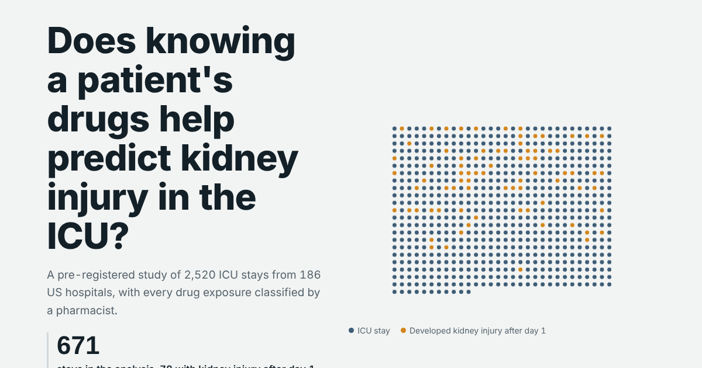

I build prediction models from hospital data, with a clinical pharmacist's eye on the drugs. I'm drawn to questions where drug knowledge changes the analysis.

## Projects

<table>
<tr>
<td width="46%" valign="top">

</td>
<td valign="top">

### [PolySafe](https://github.com/drvnv2000-lab/polysafe)
Do a patient's drugs help predict kidney injury in the ICU? A pre-registered study on 2,520 ICU stays from 186 US hospitals.

**+0.036 AUROC** with five drugs added to a logistic model. No gain with a flexible model.

[Live study](https://drvnv2000-lab.github.io/polysafe/) · [Code](https://github.com/drvnv2000-lab/polysafe)

</td>
</tr>
</table>

| | |
|---|---|
| **ADMET Benchmark** | Baselines for drug absorption, metabolism and toxicity on 22 public tasks. Results in hand, repository coming. |
| **TumorLens** | Tumour imaging with uncertainty estimates. In design. |

## Tools I use

[Portfolio](https://drvnv2000-lab.github.io/)
